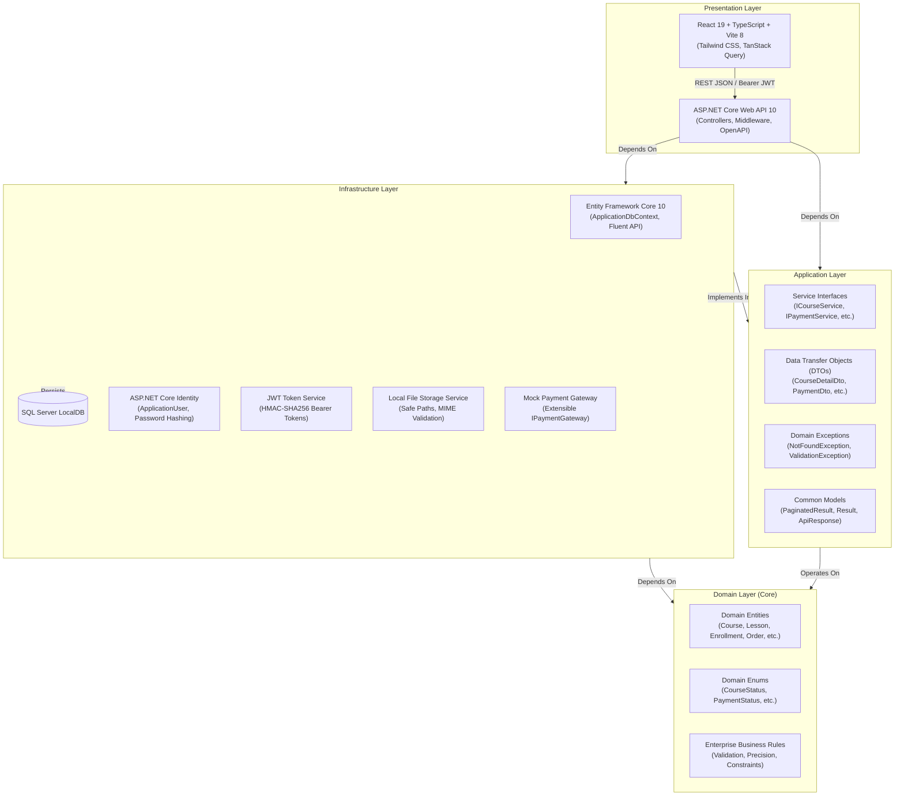
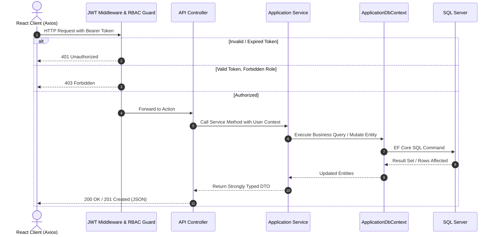

# EduSphere LMS – Software Architecture & Design

EduSphere is engineered using **Clean Architecture** (also known as Onion / Hexagonal Architecture) to achieve strict separation of concerns, testability, framework independence, and maintainability.

---

## 1. Clean Architecture Layers

---

## 2. Request & Execution Pipeline

---

## 3. Security & Data Protection Architecture

1. **In-Memory JWT Storage**:
   - Access tokens are never written to unencrypted `localStorage`.
   - Maintained in module closure in `services/api.ts`, synced strictly with browser `sessionStorage` to allow graceful single-tab refresh while mitigating persistent XSS token theft.
2. **Role-Based Access Control (RBAC)**:
   - Enforced both at API controller boundaries (`[Authorize(Roles = "...")]`) and React Router guard layers (`<ProtectedRoute allowedRoles={[...]} />`).
3. **MIME & Extension Security**:
   - Uploaded media undergo double validation: file extension whitelisting and MIME type header verification.
   - File uploads are assigned cryptographically random GUID file names before saving to disk.
4. **Range-Processing Video Streaming**:
   - Video lessons are delivered using ASP.NET Core `enableRangeProcessing: true`.
   - Allows clients to seek through videos seamlessly via HTTP 206 (Partial Content) without downloading the entire binary file upfront.

