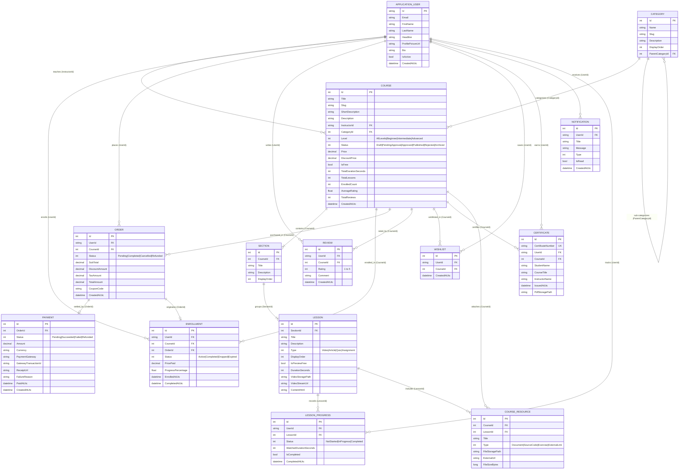

# EduSphere LMS – Database Entity Relationship Diagram (ERD)

This document details the relational data model for **EduSphere LMS**, implemented using **Entity Framework Core 10** with Fluent API configurations targeting **Microsoft SQL Server**.

---

## 1. Entity Relationship Diagram

---

## 2. Key Database Constraints & Rules

1. **Unique Index on Enrollments**: `(UserId, CourseId)` prevents duplicate student registrations in the same course.
2. **Unique Index on Reviews**: `(UserId, CourseId)` ensures a student can review a course at most once.
3. **Unique Index on Wishlists**: `(UserId, CourseId)` prevents duplicate course entries in a wishlist.
4. **Unique Index on Certificate**: `CertificateNumber` guarantees verifiable, collision-free certificates.
5. **Precision on Currency Values**: All monetary amounts (`Price`, `TotalAmount`, `SubTotal`, `Amount`) use `decimal(18,2)`.
6. **Safe Storage**: Video files, PDF certificates, and downloadable attachments store file metadata and local/cloud storage URIs, keeping binary BLOBs out of SQL Server engine memory.

